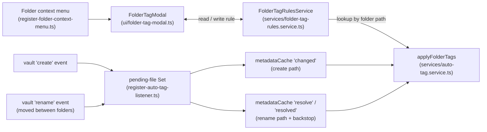

# Architecture

See `spec/design.md` for the full rationale; this is the terse reference version.

## Folder Autotag feature

- `domain/folder-tag-rule.ts` — `FolderTagRule` type, `normalizeTags`, `parseTagInput`. No
  `obsidian` import; pure functions.
- `services/folder-tag-rules.service.ts` — owns `PluginSettings.folderTagRules`: get/set/remove a
  rule, and keeps it correct across a folder rename or delete (`vault.on('rename'|'delete')`,
  registered in `plugin.ts`'s `onload()`). Constructed against a structural `FolderTagRulesHost`
  interface, not the concrete plugin class, so it's testable without a real Obsidian `Plugin`.
- `services/auto-tag.service.ts` — `applyFolderTags(host, file, cache, rules)`: combines the note's
  folder's rule with every ancestor folder's rule up to the vault root
  (`collectAncestorTags`, walking `TFolder.parent`) — a subfolder inherits its ancestors' tags in
  addition to its own, with no "nearest wins" shadowing (see `spec/design.md`'s "Subfolder
  inheritance"). Reads the note's current tags via `getAllTags(cache)` (frontmatter **and**
  inline, unified by Obsidian's own `MetadataCache` — not Dataview, not a hand-rolled scanner; see
  `spec/design.md`'s "Why not Dataview"), and writes any missing tags via
  `FileManager.processFrontMatter`. Constructed against a structural `AutoTagHost` interface
  (`{ fileManager: Pick<FileManager, 'processFrontMatter'> }`) for the same testability reason, and
  because the `obsidianmd` lint ruleset forbids casting fakes to `App`/`TFile`/`TFolder`. Also
  exports `applyRuleToExistingNotes(host, folder, rules)`, which recurses through
  `folder.children` (`collectMarkdownFiles`) and reruns `applyFolderTags` against every existing
  markdown note in the subtree — used by `FolderTagModal`'s Save button so a newly saved rule
  reaches notes that predate it, not just ones added afterward (see `spec/design.md`'s
  "Retroactive apply on save"). Takes a `RetagHost` (`AutoTagHost` + `metadataCache.getFileCache`),
  same structural-interface reasoning as `AutoTagHost`.
- `commands/register-auto-tag-listener.ts` — one shared `pending: Set<string>` of file paths, fed
  by `vault.on('create')` (gated behind `workspace.onLayoutReady()` so it never fires for the
  vault's pre-existing files) and `vault.on('rename')` (only when the parent folder actually
  changed, via `getParentPath` — a plain in-place rename is ignored), and resolved by whichever of
  `metadataCache`'s `changed`, `resolve`, or `resolved` fires first with that path's
  `CachedMetadata` actually available. A moved file's cache is **not** reliably readable
  synchronously at `rename` time (confirmed via live-vault testing, despite it having existed
  before the move) — `changed` is documented to never fire for a rename, so `resolve`/`resolved`
  are what make the rename path actually resolve; see `spec/design.md`'s "Moving a note into a
  configured folder" for the full story, including the wrong first assumption it corrects.
- `commands/register-folder-context-menu.ts` — adds a **Set Auto-Tag** item to a folder's
  `file-menu`, opening `FolderTagModal`.
- `ui/folder-tag-modal.ts` — a `Modal` that shows/edits a folder's tag list as a comma/newline
  text field, persisting through `FolderTagRulesService`.
- `plugin.ts` — wires all of the above into `onload()`; extends `PluginSettings` with
  `folderTagRules`, following the existing immer + `updateSettings` persistence pattern already
  used for the `enabled` setting.
