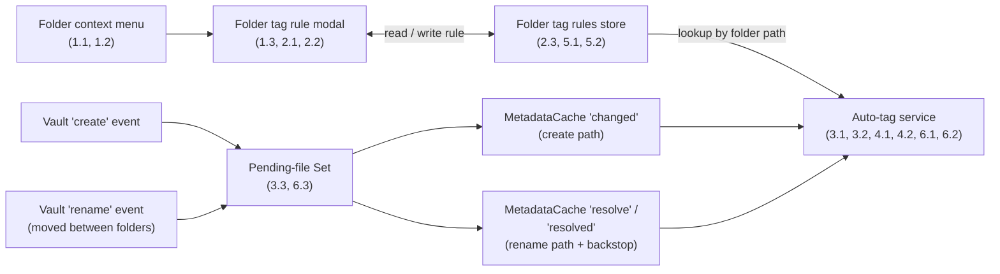
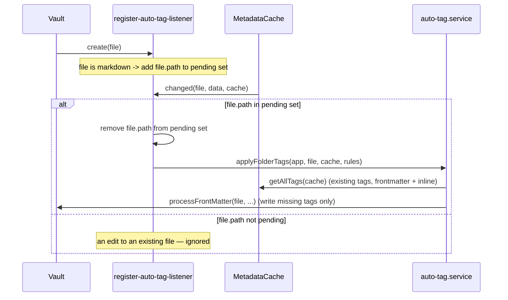

## Design: Folder Autotag

Architecture and design decisions derived from `spec/requirements.md`. See `spec/tech.md` for the
stack this builds on.

### Overview

The plugin lets a user right-click a folder, configure a list of tags for it, and have every note
added to that folder — created there, or moved/dragged in — receive those tags automatically,
added to the note's frontmatter without disturbing tags the note already has.

Three moving parts, mapped to the existing empty scaffolding folders:



- **`src/app/domain/folder-tag-rule.ts`** — the `FolderTagRule` type and tag-normalization helpers.
  Framework-independent (no `obsidian` import), so it is trivial to unit test.
- **`src/app/services/folder-tag-rules.service.ts`** — owns the folder→tags mapping: get, set,
  remove, and keeping the mapping correct when a folder is renamed or deleted. Depends on the
  plugin's settings persistence (`updateSettings`/`this.settings`), not on the UI.
- **`src/app/services/auto-tag.service.ts`** — given a `TFile` and its now-resolved
  `CachedMetadata`, combines its folder's rule with every ancestor folder's rule up to the vault
  root (see "Subfolder inheritance" below) and applies any missing configured tags via
  `FileManager.processFrontMatter`, reading the note's existing tags (frontmatter **and** inline)
  from that same cache. Also exports `applyRuleToExistingNotes`, which reruns that same logic
  against every existing note already in a folder's subtree — see "Retroactive apply on save"
  below.
- **`src/app/commands/register-folder-context-menu.ts`** — registers the `file-menu` workspace
  event, adds the **Set Auto-Tag** item for folders only, and opens the modal. Renamed from "Auto
  tagging" on explicit direction, in two steps: the literal string first had to become
  sentence-cased "Set auto-tag" (a `MenuItem`'s plain string-literal `.setTitle(...)` argument is
  exactly what the `obsidianmd/ui/sentence-case` lint rule checks), but the exact "Set Auto-Tag"
  capitalization was still wanted — resolved by adding `'Auto-Tag'` to the rule's `brands` list in
  `eslint.config.ts` (the sanctioned escape hatch already used there for a few other proper nouns;
  see its own comments for why `brands` must spread `DEFAULT_BRANDS` rather than replace it, and
  why an _ordinary_ UI word must never be added the same way). `requirements.md`'s "Auto Tagging" is
  the original concept name from before this rename, not literal UI copy either way.
- **`src/app/commands/register-auto-tag-listener.ts`** — one shared `pending: Set<string>` of file
  paths fed by two triggers (`vault.on('create')`, gated behind initial layout — see "Startup event
  ordering" below — and `vault.on('rename')` for a move into a different folder — see "Moving a
  note into a configured folder" below), and resolved by whichever of `metadataCache`'s `changed`,
  `resolve`, or `resolved` events fires first with that path's cache actually available.
- **`src/app/ui/folder-tag-modal.ts`** — a `Modal` subclass that identifies the folder being
  configured and lets the user edit its tag list.
- **`src/app/plugin.ts`** — wires the above into `onload()`; extends `PluginSettings` with the new
  `folderTagRules` field, following the existing immer + `updateSettings` persistence pattern
  already used for `enabled`.

### Data model

```ts
// src/app/domain/folder-tag-rule.ts
export interface FolderTagRule {
    /** Vault-relative folder path; also the storage key (see "Folder identity" below). */
    folderPath: string
    /** Normalized tags (no leading '#', trimmed, de-duplicated), in user-entered order. */
    tags: string[]
}
```

Persisted shape, alongside the existing `enabled` field:

```ts
// src/app/types/plugin-settings.intf.ts
export interface PluginSettings {
    enabled: boolean
    /** Keyed by folder path for O(1) lookup on every vault "create" event. */
    folderTagRules: Record<string, string[]>
}
```

A `Record<string, string[]>` (folder path → tags) is preferred over an array of `FolderTagRule` for
the on-disk/in-memory shape: the auto-tag service does one lookup per file creation and a folder
path is already a natural unique key (Req 5.2 — "different folders shall be able to have different
configurations" — a folder cannot usefully have two rules at once, so the map's built-in uniqueness
matches the domain). The modal and any future settings-overview UI convert to/from
`FolderTagRule[]` at the edges, the same way `getSettingDefinitions()` already converts declarative
definitions to/from `this.plugin.settings` in `settings-tab.ts`.

`loadSettings()` in `plugin.ts` gets the same defaulting treatment the `enabled` field already has:
if `loadedSettings.folderTagRules` isn't a plain object, default it to `{}` and mark
`needToSaveSettings`, so upgrading from a pre-feature `data.json` doesn't crash.

### Tag normalization (Req 2.1, 2.2, 4.2)

Applied both when saving a rule from the modal and when reading a note's existing tags before
merging:

- Strip a leading `#`.
- Trim surrounding whitespace.
- Drop empty strings (e.g. trailing comma in "work, ").
- De-duplicate case-sensitively (`"work"` and `"Work"` are treated as different tags, matching how
  Obsidian itself treats tag case — it does not fold case for the tags index).

This lives in `domain/folder-tag-rule.ts` as a pure `normalizeTags(input: string[]): string[]`
function so the service and the modal both use the exact same rule, and it's cheap to unit test.

### Folder identity across rename/move

Requirement 5.3 says "adding a note to a folder shall use the rule associated with that
**destination folder** at the time of addition" — if a folder is renamed after its rule is
configured, the rule must still apply to it, or the feature silently breaks on the very first
rename. Since the store is keyed by path, `folder-tag-rules.service.ts` also subscribes to the
vault's `rename` event (`TAbstractFile`, `oldPath`) and, when the renamed entry is a `TFolder` with
an existing rule, moves the rule from `oldPath` to the new `file.path`. It subscribes to `delete`
the same way to drop the rule for a removed folder (Req 6.3 — "until the folder's configuration is
... removed" — a deleted folder counts as removed).

This is inferred implementation necessity, not a stated acceptance criterion — call it out
explicitly during review since it's easy to assume path-keyed storage "just works."

### Why not Dataview

Not used, and not taken as a dependency. Dataview is a separate community plugin — an optional
query engine users may or may not have installed — and it has no bearing on this feature: Dataview
_reads_ tags to answer queries, it doesn't help _write_ a tag into a note, which is this plugin's
entire job. Requiring another community plugin for core functionality would also fail Obsidian's
own plugin guidelines ("avoid large dependencies," don't make a feature depend on a separate
plugin the user has to separately discover and install).

The property that matters — Dataview treating a frontmatter tag and an inline `#tag` as the same
thing — isn't actually a Dataview behavior at all. It comes from Obsidian's own core
`MetadataCache`: `getAllTags(cache)` (exported by the `obsidian` package) already "combines all
tags from frontmatter and note content into a single array" (per its own doc comment). Dataview's
tag resolution is built on top of that same cache, not an independent implementation. So the
correct fix isn't to adopt Dataview — it's to read tags through the cache Obsidian already
maintains, the same source Dataview itself uses, instead of parsing only the frontmatter object by
hand as the first draft of this design did.

### Startup event ordering and the create/changed pairing (load-bearing, not a stated requirement)

Obsidian's `vault.on('create', ...)` fires once for **every file already in the vault** during the
initial index load, not only for genuinely new files. A naive `registerEvent` in `onload()` would
therefore retroactively tag the user's entire existing vault the first time the plugin loads with a
rule configured. The listener must not run until the initial vault index has settled:

```ts
this.app.workspace.onLayoutReady(() => {
    this.registerEvent(this.app.vault.on('create', (file) => { ... }))
})
```

This mirrors the pattern already used in `src/app/whats-new.ts` (`onLayoutReady` gating).

Separately, `getAllTags` needs a `CachedMetadata` to read from, and that cache is not guaranteed to
be populated at the exact instant `create` fires — Obsidian parses a new file's content
asynchronously, and a note created with body content already present (duplicated, or filled in by
another plugin such as Templater immediately after creation) may not have its inline tags indexed
yet. Reading a not-yet-resolved cache would silently under-count existing tags and risk exactly the
duplicate Req 4.2 forbids.

The fix is to trigger the actual tagging off `metadataCache.on('changed', (file, data, cache) => ...)`
instead of directly off `create`: that event fires once the cache for a file is (re)computed and
hands the resolved `CachedMetadata` straight to the callback — no separate `getFileCache` lookup,
and no race. `create` is still needed to know _which_ files are new (`changed` alone fires for every
edit to every file, not just new ones), so the two are paired:



The pending set is a plain `Set<string>` of file paths, held in `register-auto-tag-listener.ts` and
cleared on unload (`plugin.register(() => pending.clear())`). It is shared with the rename/move
path below — see "Moving a note into a configured folder" for why relying on `changed` alone
turned out not to be enough, and how `resolve`/`resolved` back it up for both paths.

### Applying tags (Req 3.1, 3.2, 4.1, 4.2)

`auto-tag.service.ts` exposes:

```ts
export interface AutoTagHost {
    fileManager: Pick<FileManager, 'processFrontMatter'>
}

export async function applyFolderTags(
    app: AutoTagHost,
    file: TFile,
    cache: CachedMetadata,
    rules: Record<string, string[]>
): Promise<void>
```

`AutoTagHost` is a structural slice of `App` (same pattern as `FolderTagRulesHost` in the rules
service) — a real `App` satisfies it since it has a `fileManager: FileManager`, but a test only has
to fake `{ fileManager: { processFrontMatter } }`, not the entire `App` class. The `obsidianmd`
lint ruleset forbids casting object literals to `TFile`/`TFolder`/`App` (`no-tfile-tfolder-cast`
and the project's own ban on `as unknown as`), so a narrower parameter type is what makes the
function testable without either a disallowed cast or a fully-stood-up fake `App`.

Steps:

1. Skip if `file.parent` is null (shouldn't happen for a real vault file, but `TAbstractFile.parent`
   is nullable in the API).
2. Collect the note's configured tags via `collectAncestorTags(file.parent, rules)` — the union of
   `rules[folder.path]` for the note's folder and every ancestor up to the vault root (see
   "Subfolder inheritance" below); skip (no-op) if that combined list is empty.
3. Skip if the rule's tag list is empty (a rule with zero tags configured has nothing to add).
4. Read the note's current tags with `getAllTags(cache) ?? []` — frontmatter **and** inline tags
   together, in whatever form Obsidian's own cache produces them — and normalize with the same
   `normalizeTags` helper used for configured tags (Req 2.1/2.2), so the leading `#` `getAllTags`
   adds is stripped for a clean case-sensitive comparison.
5. Compute `toAdd = configured - existing` (Req 4.2's "no duplicate instance" — now checked
   against every tag Obsidian itself considers the note to already have, not just frontmatter).
6. If `toAdd` is empty, stop — nothing to write, no need to touch the file at all.
7. Otherwise call `app.fileManager.processFrontMatter(file, (frontmatter) => { ... })`:
   read `normalizeTags(parseFrontMatterTags(frontmatter) ?? [])` (the frontmatter's own tags,
   normalized the same way — `parseFrontMatterTags` may hand tags back with a leading `#`, and
   without stripping it here the written array could end up a mix of `#`-prefixed and bare tags)
   and set `frontmatter.tags = [...currentFrontmatterTags, ...toAdd]`, always as a bare-form array.
   Every other frontmatter key is left untouched — `processFrontMatter`'s callback mutates in place
   and never reassigns `frontmatter` itself — which is what Req 4.1 ("existing tags... remain
   assigned") actually depends on structurally, not just for the `tags` key.

### Moving a note into a configured folder (Req 3.1, 3.2, 3.3)

Originally scoped out (see history: an earlier draft of this document listed "moving/dragging an
existing note into a configured folder" under "Out of scope," reasoning that Req 3's "a note is
added to a folder" reads naturally as creation). Corrected after a live-vault test: dragging a note
into a configured folder visibly did nothing, and manual verification of Task 4 flagged that as a
bug against a reasonable reading of "added to a folder" — moving counts as adding it there, not
just creating it there. `vault.on('create')` never fires for a move (Obsidian represents a move as
a `rename` event with a changed path, not a create+delete pair), so it needs its own listener.

**First attempt was also wrong**, on a second, more specific assumption: that a moved file already
existed, so its `CachedMetadata` must already be resolved and readable synchronously via
`getFileCache` right in the `rename` handler. Diagnostic logging against the live vault
(`console.warn` calls temporarily added to `register-auto-tag-listener.ts`, since the repo's
`no-console` lint rule allows `warn`/`error`/`debug` but not `log`, and Chrome DevTools hides
`debug` under a "Verbose" filter that isn't on by default — both worth remembering for the next
time this needs debugging) showed `getFileCache` returning `null` immediately after a move, in
**both** directions. So the cache is not reliably ready at the instant `rename` fires, the same
problem `create` already had — but the `create` fix (wait for `metadataCache.on('changed')`)
doesn't transfer: that event is explicitly documented to never fire for a rename ("not called when
a file is renamed, for performance reasons").

The actual fix unifies all three trigger paths (create, rename-as-move, and whatever eventually
resolves a still-pending file) around one `pending: Set<string>` of file paths and one `tryApply`
that resolves a pending path the moment a cache is available for it:

```ts
const tryApply = (file: TFile): void => {
    const cache = plugin.app.metadataCache.getFileCache(file)
    if (cache === null) return
    pending.delete(file.path)
    void applyFolderTags(plugin.app, file, cache, plugin.settings.folderTagRules)
}

plugin.registerEvent(
    plugin.app.vault.on('rename', (file, oldPath) => {
        if (!(file instanceof TFile) || file.extension !== 'md') return
        if (getParentPath(oldPath) === getParentPath(file.path)) return // renamed in place
        pending.add(file.path)
        tryApply(file) // fast path, for the cases where the cache is already there
    })
)

// Neither is guaranteed alone, so both retry every still-pending path:
plugin.registerEvent(
    plugin.app.metadataCache.on('resolve', (file) => {
        if (pending.has(file.path)) tryApply(file)
    })
)
plugin.registerEvent(
    plugin.app.metadataCache.on('resolved', () => {
        for (const path of pending) {
            const file = plugin.app.vault.getFileByPath(path)
            if (file !== null) tryApply(file)
        }
    })
)
```

- **`resolve`** fires per file, "sometimes after a file has been indexed" (its own doc comment) —
  not a guarantee, but free when it happens and the most targeted signal available.
- **`resolved`** is the backstop: it fires globally, unconditionally, "each time files get modified
  after the initial load" (again, its own doc comment — no "sometimes" hedge). Re-checking every
  pending path on every `resolved` firing bounds the failure mode to "eventually consistent" rather
  than "silently never happens," which is what the naive synchronous read produced.
- Sharing one `pending` set (and `tryApply`) across `create` and `rename` is deliberate, not just
  convenient: it means `resolve`/`resolved` also serve as an extra safety net for the `create` path
  if `metadataCache.on('changed')` were ever to fire later than expected, at no extra cost.
- **In-place rename must not re-trigger tagging.** Renaming a file's name without changing its
  folder is not "adding" it anywhere, and must not retroactively tag a note that predates its
  folder's rule (see "Out of scope" below). `getParentPath` derives the containing-folder path from
  a raw path string (`path.slice(0, path.lastIndexOf('/'))`, `''` for a vault-root file) and
  compares the pre- and post-rename values with the _same_ derivation on both sides — so the
  comparison is correct regardless of whatever convention Obsidian's own root `TFolder.path`
  actually uses, since it never has to match that convention, only itself.
- No `onLayoutReady` gate is needed on the `rename`/`resolve`/`resolved` listeners: unlike `create`,
  Obsidian never fires a synthetic `rename` for the vault's pre-existing files during initial load,
  and `resolve`/`resolved` firing early (before anything is pending) is a harmless no-op over an
  empty set.

### Folder context menu & configuration modal (Req 1.1, 1.2, 1.3, 2.1, 2.2, 2.3)

`register-folder-context-menu.ts`:

```ts
this.registerEvent(
    this.app.workspace.on('file-menu', (menu, file) => {
        if (!(file instanceof TFolder)) return
        menu.addItem((item) =>
            item
                .setTitle('Set Auto-Tag')
                .setIcon('tag')
                .onClick(() => new FolderTagModal(this.app, this, file).open())
        )
    })
)
```

`FolderTagModal` (extends `Modal`):

- `setTitle` names the folder explicitly (its path, or name if unambiguous) — satisfies Req 1.3
  ("the configuration interface shall identify the folder being configured").
- Body: one `Setting` with a text input pre-filled with the folder's current tags (from the rules
  service), comma-or-newline-separated — satisfies Req 2.1 (enter tags) and 2.2 (multiple tags);
  a plain delimited text field is deliberately chosen over a chip/list widget or
  `AbstractInputSuggest` autocomplete: the requirements ask only for "select or enter tags," and a
  richer widget is scope the acceptance criteria don't call for (`AGENTS.md`'s "don't add features
  beyond what the task requires").
- **Save** button: parses the input (split on comma/newline, `normalizeTags`), calls
  `FolderTagRulesService.setRule(folder.path, tags)`, then — for a non-empty `tags` only —
  `applyRuleToExistingNotes(plugin.app, folder, plugin.settings.folderTagRules)` (see "Retroactive
  apply on save" below), then closes the modal. `setRule` is what makes Req 2.3 ("preserve the
  configured tags as part of the folder's rule") durable — persistence happens through the same
  `updateSettings` write path as every other setting, so it inherits the existing
  persist-before-commit and write-serialization guarantees already implemented in `plugin.ts`.
- **Cancel**/`Esc`: discards edits, no persistence call.
- An empty tag list on Save is valid and means "no rule" — the modal calls `removeRule(folder.path)`
  in that case rather than persisting an empty array, so a folder can be un-configured through the
  same UI it was configured with. The retroactive-apply call is skipped entirely in this case (Req
  7.4 — removing a rule must not touch any note's tags).

### Retroactive apply on save (Req 7.1, 7.2, 7.3, 7.4)

Added after the modal already shipped, on explicit direction: saving a folder's rule should tag
notes already sitting in that folder (and its subfolders, given inheritance), not just notes added
afterward — the previously-documented non-goal ("tagging notes already in a folder... is a
different, unstated feature") only ever covered _passive_ triggers (plugin reload, vault load); an
_explicit_ save action is a deliberate exception the user asked for, not a contradiction of it.

`auto-tag.service.ts` adds:

```ts
export interface RetagHost extends AutoTagHost {
    metadataCache: Pick<MetadataCache, 'getFileCache'>
}

export async function applyRuleToExistingNotes(
    host: RetagHost,
    folder: TFolder,
    rules: Record<string, string[]>
): Promise<void> {
    for (const file of collectMarkdownFiles(folder)) {
        const cache = host.metadataCache.getFileCache(file)
        if (cache !== null) {
            await applyFolderTags(host, file, cache, rules)
        }
    }
}
```

`collectMarkdownFiles` recurses through `TFolder.children`, collecting every `.md` `TFile` at any
depth. The function deliberately does **not** compute "what's new in this rule" and apply only
that delta — it re-runs the exact same `applyFolderTags` used for a freshly created note against
every existing note in the subtree, letting that function recompute each note's own full combined
ancestor tag set (Req 7.2 — a note several levels down gets the newly-saved ancestor rule's tags
_and_ whatever its own folder's rule already contributed, correctly, since `collectAncestorTags`
doesn't care whether a note is "new" or "existing"). This also means Req 7.3 ("no duplicate
instance") and the whole additive-only invariant fall out for free — a note already carrying a
configured tag simply produces an empty `toAdd` and is never written to.

`RetagHost` extends `AutoTagHost` with `metadataCache: Pick<MetadataCache, 'getFileCache'>` rather
than taking the full `App` — same reasoning as `AutoTagHost` itself (a real `App` satisfies it, but
a test fakes only the two methods actually used, and the `obsidianmd` lint ruleset forbids casting
a fake to `App` outright).

A cleared/removed rule must never reach this function (Req 7.4) — the modal only calls it when the
saved tag list is non-empty, never on the `removeRule` path.

### Multiple independent folders (Req 5.1, 5.2, 5.3)

Falls out of the data model directly: the rules map is keyed by folder path. Two folders that
aren't in an ancestor/descendant relationship (siblings, or unrelated branches entirely) share no
data — Folder A's rule cannot leak onto a note in unrelated Folder B (Req 5.1's carve-out for
subfolders is the deliberate exception, covered next). Each entry is independent (Req 5.2) and
looked up fresh at creation time, using whatever rule is current at that moment (Req 5.3) —
including a rule edited or removed seconds earlier, since the lookup always reads current
in-memory settings state, not a cached snapshot.

### Subfolder inheritance (Req 5.1, 5.4, 5.5)

Added after the initial implementation, on explicit direction: a note in a subfolder should pick up
its ancestors' configured tags too, not just its own immediate folder's. Asked whether an
ancestor's and a subfolder's rules should combine or whether the nearest one should shadow the
rest (both are defensible, and behave very differently for anyone with more than one configured
level) — the answer was to combine: every configured folder from the vault root down to the note's
own folder contributes its tags, with no level's rule shadowing another's.

`collectAncestorTags(folder, rules)` (in `auto-tag.service.ts`) walks `folder.parent` up to the
vault root (`parent === null`), collecting `rules[ancestor.path]` at each level that has one, then
reverses the walk so the combined list is root-first (a stylistic choice for a more natural
"broad category, then specific" tag order in the written frontmatter array — final tag
_membership_ doesn't depend on this, since `normalizeTags`' de-duplication is order-independent
other than which occurrence of an exact duplicate is kept). `applyFolderTags` calls this instead of
a single `rules[file.parent.path]` lookup, and everything downstream (dedup against the note's
existing tags, no-op when the combined list is empty) is otherwise unchanged.

This doesn't touch `FolderTagRulesService` at all — rules are still stored and edited one folder at
a time, keyed by exact path exactly as before. The inheritance is purely a lookup-time concern in
`auto-tag.service.ts`; a folder's own rule (if any) is still set/read/removed independently of its
ancestors' or descendants'.

### Continues without manual intervention (Req 6.1, 6.2, 6.3)

Falls out of the create/changed event pairing: once a rule exists, every subsequent note creation
in that folder re-triggers `applyFolderTags` with no user action (6.1), applying the same tag list
(rules are read fresh each time, so behavior is consistent — 6.2), and this continues until the
rule is edited (re-`setRule`) or the folder/rule is removed (6.3 — also covered by the
rename/delete handling above).

### Out of scope (explicitly, not by omission)

- Retroactively tagging existing notes as a side effect of a _passive_ trigger — a plugin reload or
  vault load never walks existing notes looking for missing tags, only an explicit modal Save does
  (see "Retroactive apply on save" above; that's Req 7, not this bullet). A plain in-folder rename
  does not count as adding a note either and must not trigger tagging — see "Moving a note into a
  configured folder" above.
- Removing a tag from a note when its folder's rule is edited to no longer include that tag.
  Requirements only describe additive tagging (Req 7.4 makes this explicit for the retroactive-
  apply-on-save path specifically, but it was already true for every other trigger).
