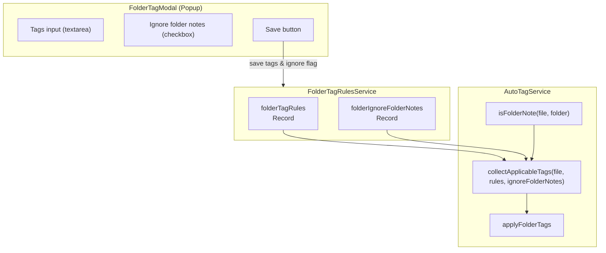

## Design: Ignore Folder Notes

Architecture and design decisions for the "Ignore folder notes" feature derived from `spec/ignore-folder-notes/requirements.md` and building upon the foundation in `spec/folder-autotag/design.md`.

### Overview

Obsidian users frequently employ the "folder note" convention (a note whose file name matches its parent folder's name, e.g., `Games/Games.md`) to serve as an index, summary, or dashboard for the folder. When automatic tagging is enabled on `Games/`, applying `#game` to `Games/Games.md` is often undesirable, while normal notes like `Games/diablo.md` should still be tagged.

This feature adds an **Ignore folder notes** checkbox to `FolderTagModal`. When checked, automatic tagging will skip applying that folder's configured tags to any note directly within that folder whose file name matches the folder name.



### Data model & settings persistence

#### Settings schema extension

In `src/app/types/plugin-settings.intf.ts`:

```ts
export interface PluginSettings {
    enabled: boolean
    /** Automatic-tagging rules, keyed by vault-relative folder path. */
    folderTagRules: Record<string, string[]>
    /** Whether to ignore folder notes for a given folder, keyed by vault-relative folder path. */
    folderIgnoreFolderNotes: Record<string, boolean>
}

export const DEFAULT_SETTINGS: PluginSettings = {
    enabled: false,
    folderTagRules: {},
    folderIgnoreFolderNotes: {}
}
```

#### Persistence & backward compatibility

1. **Parallel Record (`folderIgnoreFolderNotes`):**
   - Stored alongside `folderTagRules` in `PluginSettings`.
   - Keyed by the exact same vault-relative folder path (`folder.path`).
   - Default value is `false` (or key absent).
   - If a folder has no entry in `folderIgnoreFolderNotes`, it defaults to `false`, preserving 100% backward compatibility for existing user vaults without migration scripts.
2. **Defensive loading:**
   - In `FolderAutotagPlugin.loadSettings()` (`src/app/plugin.ts`), validate `loadedSettings.folderIgnoreFolderNotes`:
     ```ts
     if (
         typeof loadedSettings.folderIgnoreFolderNotes === 'object' &&
         loadedSettings.folderIgnoreFolderNotes !== null &&
         !Array.isArray(loadedSettings.folderIgnoreFolderNotes)
     ) {
         draft.folderIgnoreFolderNotes = loadedSettings.folderIgnoreFolderNotes
     } else {
         draft.folderIgnoreFolderNotes = {}
         needToSaveSettings = true
     }
     ```
3. **Atomic updates:**
   - Saved via `plugin.updateSettings()`, inheriting existing disk-first persistence and serialized write queue guarantees.

---

### Folder note domain definition

A file is considered a folder note for a given folder if:
1. It is directly located inside the folder (`file.parent !== null && file.parent.path === folder.path`).
2. Its file base name (name excluding `.md`) matches the folder's immediate name (`file.basename === folder.name`).

#### Helper in `src/app/domain/folder-tag-rule.ts`:

```ts
/**
 * Determines whether a file is a folder note for the specified folder.
 * Matches structurally so tests do not require real Obsidian TFile/TFolder instances.
 */
export const isFolderNote = (
    file: { basename: string; parent: { path: string } | null },
    folder: { name: string; path: string }
): boolean => {
    if (file.parent === null) {
        return false
    }
    return file.parent.path === folder.path && file.basename === folder.name
}
```

#### Case sensitivity

In Obsidian, tag indexing is case-sensitive, and vault files preserve case. The comparison `file.basename === folder.name` is exact case-sensitive matching, consistent with the rest of the plugin's domain conventions.

---

### Tag collection and inheritance logic

Currently, `collectAncestorTags(folder, rules)` collects all configured tags for `folder` and its ancestors from root to leaf.

Under the new feature, tag collection must evaluate the specific `file` being processed against each ancestor folder's rule and ignore setting:

```ts
/**
 * Combines configured tags for file across its folder and all ancestors up to
 * the vault root, omitting any folder rule whose 'ignoreFolderNotes' setting is
 * enabled if file is that folder's direct folder note.
 */
export const collectApplicableTags = (
    file: TFile,
    rules: Record<string, string[]>,
    ignoreFolderNotes: Record<string, boolean>
): string[] => {
    if (file.parent === null) {
        return []
    }

    const chain: TFolder[] = []
    let current: TFolder | null = file.parent
    while (current !== null) {
        chain.push(current)
        current = current.parent
    }

    const combined: string[] = []
    for (const ancestor of chain.reverse()) {
        const rule = rules[ancestor.path]
        if (rule === undefined) {
            continue
        }

        const shouldIgnore =
            (ignoreFolderNotes[ancestor.path] ?? false) && isFolderNote(file, ancestor)

        if (!shouldIgnore) {
            combined.push(...rule)
        }
    }
    return combined
}
```

#### Behavior across scenarios

1. **Direct folder note (`Games/Games.md` in folder `Games`):**
   - `Games` has `tags: ['game'], ignoreFolderNotes: true`.
   - `isFolderNote(Games.md, Games)` is `true`.
   - `shouldIgnore` evaluates to `true`.
   - Result: `Games.md` receives no tags from `Games`.
2. **Normal note in same folder (`Games/diablo.md` in folder `Games`):**
   - `isFolderNote(diablo.md, Games)` is `false`.
   - `shouldIgnore` evaluates to `false`.
   - Result: `diablo.md` receives `['game']`.
3. **Subfolder note (`Games/RPG/RPG.md` in folder `Games/RPG`):**
   - `Games` has `tags: ['game'], ignoreFolderNotes: true`.
   - `RPG` has `tags: ['rpg'], ignoreFolderNotes: true`.
   - For ancestor `Games`: `isFolderNote(RPG.md, Games)` is `false` (parent path is `Games/RPG` != `Games`). Tags `['game']` are included.
   - For ancestor `RPG`: `isFolderNote(RPG.md, RPG)` is `true`. Tags `['rpg']` are skipped.
   - Result: `RPG.md` receives `['game']`, but not `['rpg']`.
4. **Nested note matching ancestor name (`Games/RPG/Games.md`):**
   - `Games.md` is inside `RPG/`, not directly in `Games/`.
   - `isFolderNote(Games.md, Games)` is `false` because parent path does not match.
   - Result: receives tags normally via inheritance.

---

### UI: FolderTagModal

`FolderTagModal` (`src/app/ui/folder-tag-modal.ts`) is updated to include the checkbox setting:

1. **State:**
   - `private ignoreFolderNotes: boolean` initialized from `plugin.folderTagRulesService.getIgnoreFolderNotes(folder.path)`.
2. **Setting component:**
   ```ts
   new Setting(this.contentEl)
       .setName('Ignore folder notes')
       .setDesc('Do not apply this folder’s automatic tags to a note matching the folder name.')
       .addCheckbox((checkbox) => {
           checkbox.setValue(this.ignoreFolderNotes).onChange((value) => {
               this.ignoreFolderNotes = value
           })
       })
   ```
3. **Save action:**
   - Calls `plugin.folderTagRulesService.setRule(this.folder.path, tags, this.ignoreFolderNotes)`.
   - If `tags.length > 0`, invokes `applyRuleToExistingNotes` with both `folderTagRules` and `folderIgnoreFolderNotes`.
4. **Cancel / Close:**
   - Discards `this.ignoreFolderNotes` with no persistence call.

---

### Service layer updates: FolderTagRulesService

`FolderTagRulesService` (`src/app/services/folder-tag-rules.service.ts`):

1. **`getIgnoreFolderNotes(folderPath: string): boolean`**:
   - Returns `this.host.settings.folderIgnoreFolderNotes[folderPath] ?? false`.
2. **`setRule(folderPath: string, tags: string[], ignoreFolderNotes?: boolean): Promise<void>`**:
   - Normalizes tags. If empty, removes both tags and `ignoreFolderNotes` entry.
   - Otherwise, updates `draft.folderTagRules[folderPath]` and `draft.folderIgnoreFolderNotes[folderPath] = ignoreFolderNotes ?? false`.
3. **`removeRule(folderPath: string): Promise<void>`**:
   - Deletes `draft.folderTagRules[folderPath]` and `draft.folderIgnoreFolderNotes[folderPath]`.
4. **`handleFolderRenamed(oldPath: string, newPath: string): Promise<void>`**:
   - Moves both `draft.folderTagRules[oldPath]` to `newPath` AND `draft.folderIgnoreFolderNotes[oldPath]` to `newPath`.
5. **`handleFolderDeleted(folderPath: string): Promise<void>`**:
   - Deletes both entries.

---

### Retroactive tagging on save

`applyRuleToExistingNotes` in `src/app/services/auto-tag.service.ts`:

- Updated signature:
  ```ts
  export async function applyRuleToExistingNotes(
      host: RetagHost,
      folder: TFolder,
      rules: Record<string, string[]>,
      ignoreFolderNotes: Record<string, boolean>
  ): Promise<void>
  ```
- Calls `applyFolderTags(host, file, cache, rules, ignoreFolderNotes)` for each markdown file in the folder's subtree.
- Notes matching the folder name are filtered out during the retroactive pass if `ignoreFolderNotes` is enabled for that folder.
